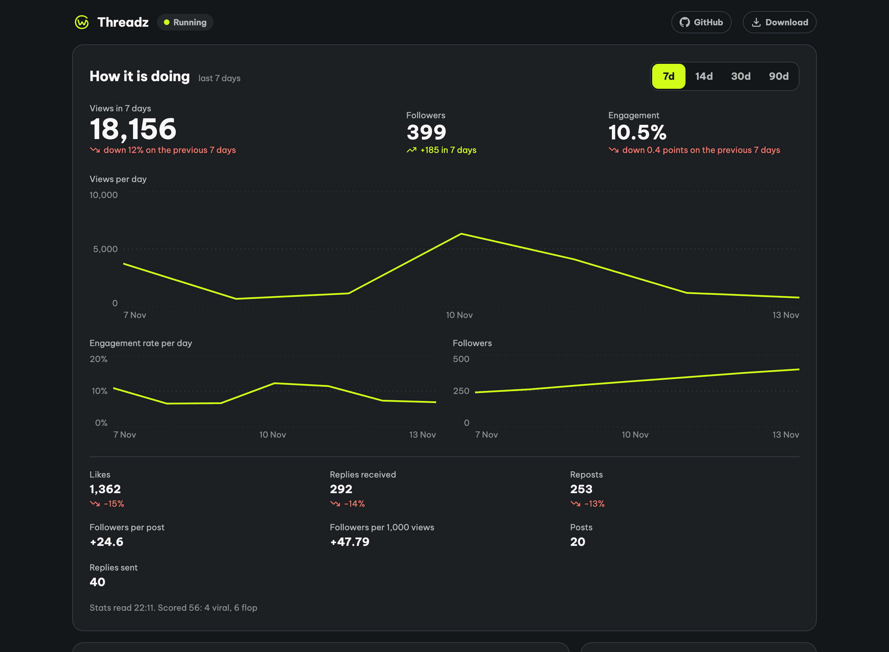

<h1 align="center">
  <picture>
    <source media="(prefers-color-scheme: dark)" srcset="docs/images/brand/threadz-logo-horizontal-white.svg">
    
  </picture>
</h1>

<p align="center">Threads on autopilot: an agent that posts, replies, reads its own stats and changes what it does.</p>

<p align="center">
  <a href="https://github.com/canhta/threadz/actions/workflows/ci.yml"></a>
  <a href="https://github.com/canhta/threadz/releases"></a>
  <a href="LICENSE"></a>
</p>



Threadz wakes on a schedule, reads what is happening on Threads, and publishes a post or a reply
with nobody approving the text. Days later it reads the numbers that post earned and feeds them
back into what it writes next.

A writer drafts, a critic rejects, and a guard checks every action in code before it reaches
Threads: blocked phrases, off-limits subjects, daily caps, a spend budget, a do-not-contact list.
You watch it from a Telegram bot and a read-only dashboard.

One Go binary, one SQLite file, no CGO.

## Try it

One wake, no keys, no network, nothing published:

```sh
git clone https://github.com/canhta/threadz && cd threadz
go run ./cmd/threadz run --once --offline
```

## Install

A release has two bundles, `linux_amd64` (the server) and `darwin_arm64` (Apple silicon, for local runs). The server bundle carries the binary, the systemd units and a ready template; the Apple silicon one carries the binary and the template. For the server:

```sh
v=$(curl -fsSL https://api.github.com/repos/canhta/threadz/releases/latest \
  | sed -n 's/.*"tag_name": *"v\([^"]*\)".*/\1/p')
curl -fsSLO https://github.com/canhta/threadz/releases/download/v$v/threadz_${v}_linux_amd64.tar.gz
tar -xzf threadz_${v}_linux_amd64.tar.gz
```

Each bundle ships a `.sha256` and an ed25519 `.sig`, and `threadz update` checks both before it
replaces anything. To build instead: `CGO_ENABLED=0 go build -o threadz ./cmd/threadz`.

## Configure

An agent is one YAML template: who it writes for, what good looks like, its caps and its budget.
Start from [`templates/viral.agent.yaml`](templates/viral.agent.yaml), every key in
[docs/template.md](docs/template.md). Credentials come from the environment
([`.env.example`](.env.example)). Templates ship with `dry_run: true`, and the default
`backend: stub` runs the whole loop without a Threads app.

Inside the extracted bundle:

```sh
./threadz check --agents .
./threadz run --agents . --db data/threadz.db
```

Server install, Threads sign-in and automatic updates: [docs/setup.md](docs/setup.md).

## Docs

[Setup](docs/setup.md) · [Design index](docs/README.md) · [One wake, step by step](docs/wake.md) ·
[Evals](docs/evals.md) · [Glossary](GLOSSARY.md)

## Contributing

[CONTRIBUTING.md](CONTRIBUTING.md). Every change passes `go vet ./...`, `go test -count=1 ./...`
and the default eval suite. Report security problems through [SECURITY.md](SECURITY.md), not a
public issue.

[MIT](LICENSE)
