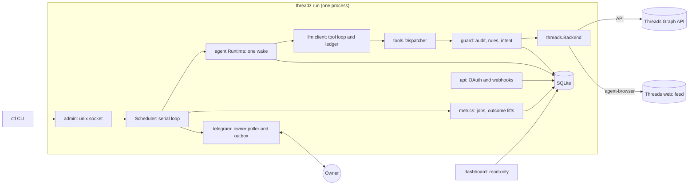

# Architecture: what are the parts, who owns what, how does data flow?

One Go binary runs a serial scheduler. Each agent is one tool-calling LLM loop bound to one template, one Threads account and one budget. Three owners hold every fact: code, the template and the agent-learned layer.

## The experiment

Given a goal, one Threads account and a budget, how far can an agent run, learn and improve by itself with nobody approving its output? Weekly measures on the agent's own account: followers, views, replies received, token cost.

## Components

| Package | Owns |
|---|---|
| `cmd/threadz` | CLI: `run`, `check`, `ctl`, `dashboard`, `eval`, `update`, `version` |
| `internal/config` | Template loading, validation, redacting `Secret` values |
| `internal/store` | SQLite, `schema.sql`, queries, retention |
| `internal/llm` | Protocol adapters, shared tool loop, ledger, embeddings |
| `internal/agent` | One wake: context assembly, scoreboard, cadence, dream and study, post-mortem, recall |
| `internal/tools` | Tool executors and the dispatcher |
| `internal/guard` | Tool table (`Specs`), limits, safety rules, do-not-contact, intent reservation |
| `internal/quality` | Writer, critic, ideas and judge calls; `rubric.json`; draft-quality scoring |
| `internal/threads` | API client, token lifecycle, `Backend` contract, `Memory` backend |
| `internal/agentbrowser` | Pinned `agent-browser` client |
| `internal/api` | Loopback HTTP for OAuth and webhooks |
| `internal/metrics` | Metric jobs, outcome lifts, post-mortem pairs |
| `internal/playbook` | Hypotheses, posterior, gate |
| `internal/trends` | Trend fetch, ranking, study sources, brief, web search |
| `internal/knowledge` | Embedded craft knowledge `threads.json` |
| `internal/telegram`, `internal/admin`, `internal/dashboard` | Owner channel, ctl socket, read-only page |
| `internal/update`, `internal/ratelimit`, `internal/logging`, `internal/stdx` | Self-update, shared limiter, event names, helpers |
| `internal/eval` | Fixtures and runner for offline evals |

Every tool implements one interface in `internal/tools`; `internal/guard` wraps the dispatcher, so no code path runs a tool without the guards. Templates are `templates/*.agent.yaml`.

## Ownership

Each fact about an agent lives in exactly one owner. The agent changes only the third. The owner changes the second by editing the template. A change to the first is a release.

| Owner | Holds | Changed by |
|---|---|---|
| Code (Go, same for every agent) | Wake loop: read, `ideas`, write, critic, guard, publish, measure; tools and argument schemas; role prompts of writer, critic and ideas (what the call does and its JSON shape, nothing about audience, language or style); hard limits (safety and privacy, untrusted-data boundaries, secret and link checks, ungrounded self-stat numbers, caps, budget and step limits, dry-run); measurement (metric jobs, outcome lifts, KPI scoreboard arithmetic, cadence from the KPI gap); storage, retention, dashboard, Telegram, self-update | A release |
| Template (per agent, fixed while it runs) | Who it writes for (audience, language, identity, voice, topics, avoided topics); what good looks like (writer and critic rules, starting examples, seed hypotheses); numbers (KPI targets, caps, budget, intervals, the timezone and the quiet hours in which no wake runs, trend sources, models and reasoning effort); hard-limit lists (blocked phrases, off-limits subjects, own accounts) | The owner, by editing the template; every key in [template.md](template.md) |
| Agent-learned (database) | Memory index and topic notes; playbook hypotheses and evidence; strategy revisions; which ideas, hooks, formats and hours won (inside the template's waking hours), measured from its own actions; contacts and do-not-contact marks | The agent through tools; code bounds every write ([learning.md](learning.md)) |

Code picks the writer's learned examples from the store; no tool is involved ([content.md](content.md)).

## Data flow

| Step | From | To | Form |
|---|---|---|---|
| Read | Threads API, browser feed, trend sources, web search | Tool result | Untrusted data, marked `untrusted: true` |
| Decide | Agent loop | Tool call | Arguments checked against the `Specs` schema |
| Draft | Brief (`angle`, `fact`, rough `text`) | Writer, then critic | Tool-free LLM calls ([content.md](content.md)) |
| Gate | Tool call | Guard | Audit row, rules, atomic intent ([guards.md](guards.md)) |
| Publish | Reserved intent | Backend | API container flow, or browser reply |
| Measure | Published action | Metric jobs at +1h, +6h, +24h | Samples, then one outcome row |
| Learn | Outcome lifts | Playbook posterior, strategy lift, dream | Counted by code, never by the agent |

## LLM layer

| Item | Fact |
|---|---|
| Config | Each agent is configured only by the inline `llm` block of its template. The catalog ([evals.md](evals.md#model-catalog)) is an input of `threadz eval`; templates never reference it |
| Adapters | `openai` (Chat Completions) and `anthropic` (native Messages). Both normalize messages, tool calls, results and token usage into the same loop and ledger. A vendor API with another wire format is not compatible by configuring its key |
| Anthropic | Pins API version `2023-06-01`. `max_tokens` is 1024 by default, 8192 when `reasoning_effort` is set (thinking tokens count against it), or the caller's output limit. Supports text and client-side function tools. Thinking is requested only when `reasoning_effort` is set |
| Thinking blocks | `thinking` and `redacted_thinking` are opaque and replayed verbatim, signatures included, ahead of that turn's other blocks. Never shown to the agent, logged, stored or sent to an `openai` request. Usage comes from `usage.output_tokens`, which includes thinking |
| Unsupported | Any other unknown content block fails closed after recording known usage. Multimodal input, streaming and server-side tools |
| Model calls per post or reply | Besides the agent loop: `ideas`, writer, critic (tool-free, so they can reason). The post-mortem judge scores only published actions and blocks nothing |
| Ledger | Local, per agent, priced from the template's inline rates. Both adapters record provider-reported input and output tokens. Flat rates do not model cache discounts, tier pricing or billed dollars; flat subscriptions expose no balance. Phases and caps: [wake.md](wake.md) |

## Runtime rules

| Rule | Fact |
|---|---|
| Template set validation | The runtime validates the whole set before initializing state: distinct IDs, operator-declared `threads.username` values (normalized, never inferred) and non-overlapping canonical profile paths, symlink ancestors included |
| Scheduler | Installs the full own-username set before starting any agent. Wakes and metric maintenance share one serial loop |
| Isolation | Notes, playbook, contacts, budgets, limits and owner controls are scoped by agent ID. Every table carries `agent_id` |
| Secrets | Live only in environment variables named by `*_env`, never in a template, log or LLM context. Loading resolves keys into redacting `config.Secret` values. The CLI reads `./.env` without overriding set variables (`THREADZ_ENV_FILE` selects another) |
| Backend | Default Threads stub is `threads.Memory`, the in-memory backend every test and eval uses; it requires `dry_run`. A configured browser or API backend permits guarded submissions |
| Flags | GNU-style long flags, `-a`/`-d` shorthands for `--agents` and `--db`. A flag beats `THREADZ_AGENTS`/`THREADZ_DB`, which beat the defaults (`templates/`; `data/threadz.db`). Usage errors exit 2, runtime failures 1 |
| Logging | One injectable `log/slog` logger, JSON to stdout by default; levels `debug/info/warn/error`, formats `json/text` (`--log-level`, `--log-format` on `check` and `run`). Event names and the metadata allowlist are in [`internal/logging/logging.go`](../internal/logging/logging.go). The SQLite audit DB is the action record. Allowlist rules: [guards.md](guards.md) |
| Evals | Offline by default, with scripted providers and injected time; they certify only client, protocol, configuration, accounting and local runtime behavior. Commands: [evals.md](evals.md) |

## Concurrency

| Component | Rule |
|---|---|
| Wakes, metrics, operator jobs | One serial loop; at most one operator job queued or running |
| Reservations | SQLite `BEGIN IMMEDIATE` protects concurrent guards and independent handles |
| Owner polling and wake storage | Share a serialized SQLite pool; no connection is held during Bot API HTTP |
| Owner poller | Own lifetime, never cancelled by a wake, browser or scheduler error |
