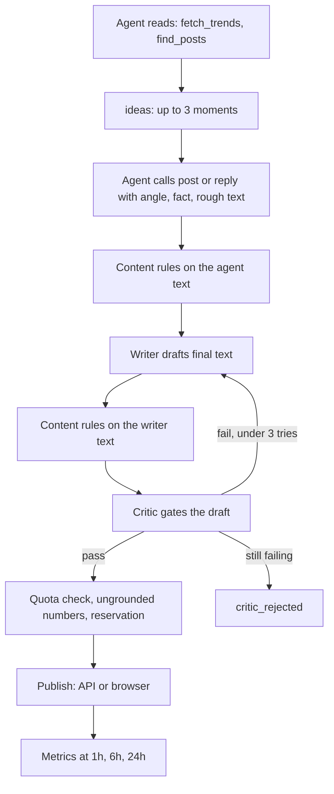

# Content: how is a post or reply made, and what does each prompt own?

Every `post` (a series counts as one draft) and `reply` is reviewed before the guard reserves it, in live and dry-run mode alike. Three tool-free LLM calls surround the agent's own loop: `ideas`, the writer and the critic. None sees the agent's conversation. They run without tools, so they can reason at a real `reasoning_effort` even though the agent's own model allows function tools only at `none`.

## Flow

| Stage | Call | Input | Output |
|---|---|---|---|
| `ideas` | Writer model, once per tool call | Persona (name, identity, `audience`, voice, `topics`, `avoid_topics`, never proposed) and every trend item (including the Trending-now topics of `find_posts` `feed`), feed post and topic post read this wake. Each item is shown by its ref (`t3` or `p12`, see [tools.md](tools.md)), never its URL. Each item carries a bracketed fact line when the read showed numbers: `[topic heat 0.82 · 2.1K posts · 3 sources · seen 2h · up 3]` for a topic or `[45m old · 120 likes · 8 replies · target score 0.71]` or `[3h old · 2 likes · 0 replies · target score 0.00 · outside window: likes_per_hour]` for a post. Items are sorted by that score, best first, at most 40, and the instructions tell the model to prefer high heat or target score and cite the numbers in `why`. Nothing from an earlier wake is offered | Up to 3 `{kind, ref, moment, why}` or none; a reply's `ref` the ref of an item; a post's `ref` the ref of an item, or empty for an idea from the persona's topics alone (blocked when `guard.trend_anchor` is on); best first |
| Writer | `writer.post_llm` for a post or series when set, else `writer.llm`; replies always `writer.llm` | Persona (name, identity, audience, voice, `style_rules`, `good_posts` or `good_replies`, `style_avoid`, `avoid_topics`), the brief (`angle`, `fact`, rough `text`), the parent post or trend text, the account's last 20 own posts and replies, learned examples | `{"texts":[...]}`, one per series part |
| Critic | `critic.llm`, else the agent's `llm` | `critic_instructions` from `internal/quality/rubric.json`, persona name, `audience`, numbered `critic_rules`, `avoid_topics` (a draft on one fails), the draft and its kind, the parent or trend text, the brief's `angle` and `fact` (what the agent read this wake: the verified basis, still untrusted data; a detail in the fact or the parent text is grounded), the last 20 own posts and replies | `{"pass":bool,"problems":[...],"scores":{hook,natural_vietnamese,specificity,forced_self_reference,target_fit,novelty}}`, each score 1 to 5 |
| Guard | Code | Reviewed text | Rules, quota, reservation ([guards.md](guards.md)) |

A Trending-now topic joins the wake as a trend item whose ref is its topic URL and whose text is title and summary; the critic reads that text as the parent of a post anchored to it, so a claim the title and summary do not support is flagged. Trending items live only in the wake's memory-only read sets and are never stored; the numbers an action was built on are stored on it ([learning.md](learning.md)).

`ideas` is offered only when the template has a `writer.llm` block, and without a writer the wake text does not name it. When `ideas` returns none the agent reads more and calls it again; an agent not behind on its KPIs may skip posting ([wake.md](wake.md)).

## Revision and refusal

| Rule | Fact |
|---|---|
| Brief | `post` and `reply` take `angle` (the one thing to say) and `fact` (the verified detail it rests on: a number, name or quote read this wake). With a writer, text is rewritten from them, so the agent's `text` may be rough |
| Pre-critic check | The writer's text meets the content rules (blocked phrases, length, links) before the critic sees it; a violation goes back as a problem |
| Revisions | A failed draft returns to the writer with the critic's problems, up to 2 revisions inside the same tool call |
| Pass | Only a passing draft reaches the reservation; its text is what is published and stored |
| Rejection | Still failing: `critic_rejected` with the problems in the hint; counts as one rejection. After 2 rejections in a wake every further write is `critic_limit` |
| Failure | A request failure or unparsable verdict: `critic_unavailable` |
| Storage | The verdict is stored on the action (`actions.critic_json`) |
| No writer | The critic judges the agent's text once, with no revision |
| Code-owned critic rule | A draft that repeats an image or joke of the recent own posts fails |
| Code-owned closing check | Before the critic, a draft whose closing token (the trailing emoticon or emoji run, runs of one symbol collapsed so `:)))` equals `:))))`, or a last-word laugh such as `kkk` or `haha`) ends at least 3 of the last 10 own texts of the same mode goes back to the writer as a problem; the writer also sees those recent endings and is told to avoid them. If the last try still ends that way the call is refused as `repeat_ending` |
| Billing | Writer, critic and `ideas` requests are billed to ledger phase `critic`, each at the prices of the block that served it, which counts toward `limits.max_usd_per_day` with the agent phase |
| Dry run | `threadz ctl draft --agent ID --input FILE` runs writer and critic on a fixed JSON list (`id`, `kind`, `text`, optional `angle`, `fact`) in a scratch database, no guard, no publishing; prints each try, verdict and spend |

## Learned examples

Code picks up to 3 of the account's own live posts (or replies, by kind) of the last 30 days: viral first, then the highest reach lift above 0. They sit beside the template's starting examples in the writer prompt. No tool is involved.

## Prompt ownership

| Prompt or text | Code owns | Template owns |
|---|---|---|
| Agent system prompt | Section order, hard-limits block, harness rules, phase job and tool list | Goal, persona identity, voice, examples, `style_avoid` |
| `ideas` | Role and JSON shape | `persona.audience`, identity, voice (the reader and topics to follow) |
| Writer | Role, JSON shape, series limit, untrusted-data rule | `persona.audience`, identity, voice, `style_rules`, good examples, `style_avoid`, model and `reasoning_effort` |
| Critic | Role, JSON shape and score axes, the repeated-image rule, untrusted-data rule | `persona.audience`, numbered `persona.critic_rules`, model and `reasoning_effort` |
| Owner-facing copy | All of it: English plain text with counts, limits and times (the model never writes them) | `persona.name` names the agent in a shared bot and in `/start` |

The role prompts say nothing about the audience, the language or the style: those come from the template. The viral template carries the Vietnamese GenZ text and the research rules of `.research/viral-threads-vn.md`.

## Hooks, series and the comment loop

The first line of a post decides the scroll-past, which the feed ranker predicts, and replies make up about half of Threads views. Engagement bait is demoted and stays refused (`engagement_bait`). The template's `style_rules` carry the craft guidance.

| Element | Fact |
|---|---|
| Hook types | `number`, `contrarian`, `curiosity_gap`, `personal_stake`, `trend_detail` (`store.HookTypes`). A post or reply may name one in `hook`; a post under `guard.trend_anchor` must. Stored on the action beside the `rationale` |
| Trend anchor | With `guard.trend_anchor`, a post carries `hook`, `rationale` and `trend`; the first line stands alone as the hook, at most 80 characters. The rationale and hook are stored; a `t` ref lives in guard memory for the wake only, a `p` ref resolves from `seen_posts` for 7 days |
| Series | A post of 2 to 5 parts chained by self-replies. Metrics are measured on part 1 only; later parts are not scored |
| Comment loop | Each wake: `search` with `recent` true for posts under 60 minutes old, `profile` for the author's `follower_count`, and an early reply with one specific detail to accounts 2 to 10 times the agent's size. The ratio is the agent's choice, not a guard: an author of unknown size is not refused. Every reply cap, `do_not_contact`, and the identity and harassment rules apply unchanged |
| Measuring a reply | The API gives no profile-visit count per reply. Account `views` of `threads_insights` (profile views) and `followers_count` come from `read_own_metrics`; per-reply results are the reply's own `/{id}/insights`. Any link between a reply and profile visits or followers is an approximation over the account series, not a measurement |

## Owner notes

Owner free text that is neither a command nor a reply becomes an owner note. It stays open until a post or reply names it with `answers_note` (stored on the action) or 48 hours pass. Open notes open the wake's user message as its first task. While one is open, a `post` that names none is refused as `owner_note_open`; naming a note that is not open is `invalid_tool_arguments`.

## Quality scoring

[`internal/quality`](../internal/quality) scores draft quality against the template's `style_rules`, `bad_examples` and `style_avoid`, plus code checks for length, repeated images and ungrounded self-stat numbers. It is an eval tool, not a publish gate; checks are listed in [evals.md](evals.md).
