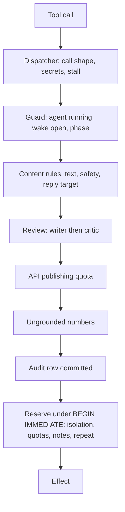

# Guards: which refusal reason codes exist, what rule is behind each, and where is it enforced?

Guards are code the agent cannot disable. Every tool call is audited first, then checked, then reserved or run. A refusal is stored in `tool_calls.blocked_by` and returned to the model as `{"blocked": code, "hint": ...}`; fixed hint text per code is in [`internal/guard/blocked.go`](../internal/guard/blocked.go). The tool table is [tools.md](tools.md).

## Enforcement order

"Template" in the Source column means the rule reads a template key ([template.md](template.md)); "code" means the rule is fixed.

## Reason codes

| Reason | Rule | Source | Enforced at |
|---|---|---|---|
| `invalid_tool_call_id` | Tool call has an empty id | code | dispatcher |
| `unsupported_tool_type` | Only function tool calls | code | dispatcher |
| `unknown_tool` | Tool not in `guard.Specs` | code | dispatcher |
| `invalid_tool_arguments` | Arguments do not match the schema, naming the argument; also an unknown `source` or `hook` (enums in the schema). An optional argument sent empty (`""`, `[]` or `null`) counts as not sent | code | dispatcher, content, reserve |
| `post_not_readable` | `read_post` or `read_replies` got a `p` ref of a post only a browser read showed (no API id); its text is already in that read | code | dispatcher |
| `sensitive_arguments` | Arguments contain a configured secret | code | dispatcher |
| `repeat_refused` | Same call failed the same way 3 times | code | dispatcher |
| `stall_stop` | Second `repeat_refused`, or 10 identical successful results; ends the wake | code | dispatcher |
| `tool_closed` | The tool (for `find_posts`, the source) was refused 3 times for the same reason (for a reason about one post or person, the same `target`; time gates such as `min_minutes_between_posts`, `replies_per_hour`, `min_seconds_between_actions` and `reply_breaker` never count, and `browser_replies_per_day` never closes `reply`, whose API replies stay allowed); a time gate that reopens after the wake's 30-minute horizon, and `api_quota_exhausted`, close the tool at the first refusal, and the hint says when it reopens. When `post` and `reply` are both closed or hidden the wake ends at once with `end_reason` `nothing_to_do`, which is not a failure; closed for the rest of the wake. Does not feed `stall_stop`; the identical call repeated still ends the wake through `repeat_refused` | code | dispatcher |
| `tool_hidden` | The tool or `find_posts` source is not offered this wake (a closed write gate, a source the Meta app may not use); a call to it is refused. Does not feed `stall_stop`; the identical call repeated still ends the wake through `repeat_refused` | code | dispatcher |
| `tool_call_cap` | The wake made 40 tool calls; the first call past it is refused, the second ends the wake (`end_reason` `tool_call_cap`) | code | dispatcher |
| `limit_per_wake` | A capped tool was called past its per-wake cap: `find_posts` source `topic` 3 and `feed` 2, `web_search` 3, `fetch_trends` 1, `notify_owner` 2, `ask_owner` 1, `mark_do_not_contact` 3, `ideas` 3 | code | executor |
| `browser_stopped` | Browser logged out or captcha already stopped the agent | code | dispatcher |
| `audit_failure` | Audit write failed; fail closed | code | dispatcher |
| `agent_not_running` | Agent paused or killed | code | guard, reserve |
| `wake_not_open` | The wake has ended | code | guard, reserve |
| `phase_read_only` | Tool not allowed in this phase | code | guard |
| `text_length` | Any part over 500 Unicode code points; with `guard.trend_anchor`, a post's first line over 80 | code, template flag | content |
| `blocked_phrase` | Text contains a `guard.blocked_phrases` entry (safety phrases only; case-folded substring) | template | content |
| `identity_targeting` | Targets a person's identity: appearance, gender, region, age, private life | code (`internal/guard/safety.go`) | content |
| `political_recommendation` | Recommends a political choice | code | content |
| `engagement_bait` | Asks for "comment X", "tag a friend", shares or follows | code | content |
| `post_brief` | With `guard.trend_anchor`, a post lacks `hook` or `rationale`, or the rationale is multi-line or over 300 characters | template flag | content |
| `too_many_parts` | A series with 5 or more later parts | code | content |
| `find_args` | `find_posts` arguments do not fit the `source`, or `topic` is not the `t` ref of a Threads topic that `feed` returned this wake | code | executor |
| `no_trend_anchor` | With `guard.trend_anchor`, `trend` was not the `t` ref of a trend or source noted this wake, or the `p` ref of a post this wake issued | template flag | content |
| `own_account` | Interaction with a configured own username, own profile or post URL, or a confirmed own publication URL, even when the supplied author disagrees; mentions and Threads links to own accounts | template (`threads.username`) | content, reserve |
| `shared_promotion_link` | A post promotes a link already reserved by another agent; checks all prior intents including dry-run, failed and uncertain | code | reserve |
| `reply_target_host` | The stored post has no usable author in a `threads.com` or `threads.net` post URL (optional `www.`, http normalized to https) | code | content |
| `unknown_target` | `reply.target` is not a `p` ref this wake issued, through a read, the inbox or the open reply candidates; the hint says to pick one from the candidates or the inbox, or read with `find_posts` first | code | content |
| `target_outside_window` | The stored figures of the target, aged to now, are outside the `targets.*` window ([wake.md](wake.md)); the hint names each broken knob with the post's figure and the limit. An answer to a reply listed in the wake's inbox is exempt; a target that never showed figures is not checked | template (`targets.*`) | content |
| `reply_url` | A reply contains a URL | code | content |
| `reply_mention` | A reply mentions a username other than the author it answers | code | content |
| `invalid_policy` | A limit is not positive | template | content |
| `critic_rejected` | Draft still failing after 2 revisions; problems in the hint; counts as one rejection | code, template (`persona.critic_rules`) | review |
| `critic_limit` | 2 rejections already this wake; every further write refused | code | review |
| `critic_unavailable` | Review request failed or verdict unparsable | code | review |
| `api_quota_exhausted` | The API's own publishing quota (250 posts, 1000 replies per 24 h at the measured account) is used up; a series needs one reply per later part | code | API quota |
| `api_quota_unreadable` | The quota cannot be read; fail closed | code | API quota |
| `ungrounded_number` | A number next to a `guard.self_stat_units` unit does not equal, at the precision written, a value on the facts sheet | template (units) | after review |
| `do_not_contact` | Target username is on the permanent list | code | reserve |
| `posts_per_day` | `limits.posts_per_day` used (local day in `schedule.timezone`, template's mode); stops the wake with `action_limit` | template | reserve |
| `replies_per_day` | `limits.replies_per_day` used; stops the wake with `action_limit` | template | reserve |
| `browser_replies_per_day` | `limits.browser_replies_per_day` used (default 5); closes only the browser path: replies to inbox items and to candidates with an API id stay allowed, and with it used up the data message leaves browser-only candidates out | template | reserve |
| `replies_per_hour` | `limits.replies_per_hour` own replies in the last 60 minutes (the hint names the time the oldest leaves the window); 0 is off | template | reserve |
| `reply_breaker` | Replies are paused for `limits.breaker_hours`: the newest `limits.breaker_actions` own actions with a metric sample earned fewer than `limits.breaker_min_likes` likes plus replies in their newest samples. The first refusal queues one owner notice, whose time is the trip time, so a restart keeps the pause; the next judgement counts only actions posted after the pause began. Posts are unaffected | template | reserve |
| `replies_per_user_7d` | `limits.replies_per_user_7d` replies to one username in the rolling 7 days; an answer to a reply listed in the wake's inbox ([wake.md](wake.md)) is exempt, so a conversation continues, while it still counts toward `replies_per_day` and the person's count | template | reserve |
| `thread_per_day` | One reply per thread per local day; each reply to us is its own thread, so a back-and-forth answers every new reply once | code | reserve |
| `replies_per_conversation` | The agent already made `limits.replies_per_conversation` replies under the same root post (the hint names the count), unless its first reply there reached `limits.conversation_hot_likes` likes or `limits.conversation_hot_replies` replies in its newest stored metric. A reply to a feed or search post is rooted at that post; an answer to an inbox reply inherits the root of our reply it answers, and a reply to a comment on our own post is rooted at that comment, so one commenter is one conversation. Rows stored without a root, and mentions, are their own conversations. The inbox lists no reply from a capped conversation | template | reserve |
| `min_seconds_between_actions` | Spacing since the newest action under `limits.min_seconds_between_actions`; the hint names the next allowed time | template | reserve |
| `min_minutes_between_posts` | A post within `limits.min_minutes_between_posts` of the newest own post; replies are not affected; the hint names the next allowed time | template | reserve |
| `note_not_open` | `answers_note` names a note that is not open | code | reserve |
| `owner_note_open` | An owner note is open and the post names none via `answers_note` | code | reserve |
| `repeat_ending` | The final text's closing token (trailing emoticon or emoji run, or a laugh such as `kkk`) already ends 3 of the agent's last 10 live actions (dry-run actions count only in dry-run mode); the writer gets two rewrites first, the hint names the token and says to end differently | code | reserve |
| `repeat_topic` | Post's anchor (the stored URL or title) equals that of an own post of the last 24 h, or its first line shares at least two words (4+ letters, links left out) and half of the smaller word set with one | code | reserve |

Dashboard-only codes: the `lesson_*` reasons of a lesson the text gate refused, and `stale_ref` (a lesson that names a `p` or `t` ref), show as "blocked", not as guard codes.

Every refusal the model reads carries one sentence: what happened and the next valid action (`internal/guard/blocked.go`; `TestEveryReasonCodeHasAFixedHint`). The second refusal of a tool for one reason adds a sentence naming the next valid action; the third closes the tool. The hints are the only place the policy is stated to the model: tool descriptions do not repeat it.

## Rules behind several codes

| Rule | Fact |
|---|---|
| Series | One `post` call, one decision. Every part passes every text rule; one refused part refuses the whole series. It reserves one `actions` row: counts once toward `posts_per_day` and spacing; later parts count toward neither `replies_per_day` nor per-user caps. The reserved text other agents' isolation checks read includes every part |
| Counting | Quotas, spacing, dedupe, isolation and the wake-context counters count only intents of the template's mode (dry-run rows while `dry_run` is true, live rows once false), failed and unknown outcomes included. The reserve step inserts the intent and contact counters atomically; persistence errors fail closed |
| Days | Every daily cap (posts, replies, threads, spend) counts on the local day in `schedule.timezone`. Contacts use the exact rolling interval `(now - 7 days, now]` |
| Unit of length | The 500 ceiling counts Unicode code points |
| Matching | Blocked and stop phrases: case-insensitive substring. Safety category patterns match case-folded text and are not configurable. `persona.style_avoid` never blocks; a phrase in both lists is a configuration error |
| Facts sheet | USD spent and left today, tokens today, own post and reply counts, latest views and replies per own action, latest own follower count after a `read_own_metrics` read. Cent figures match USD times 100. Numbers without a listed unit are not checked; a follower figure is refused until a follower count has been read. A reply may quote the post it answers |
| Pre-reserve cleanup | At the start of a normal wake, a live post intent with no thread URL and no media id is marked failed (stops counting toward `posts_per_day`) when the listing of the account's own threads shows no post with its text. A failed listing proves nothing |
| Restart | Reserved intents are never replayed. A daily-quota refusal leaves the agent eligible for a later wake |

## Do-not-contact

| Entry path | How |
|---|---|
| Stop request | `Guard.ObserveStopRequest`, harness-only: an addressed reply whose text matches a stop phrase adds a permanent entry; inbound text is not saved. `guard.stop_phrases` replaces the Vietnamese/English defaults in [`internal/guard/guard.go`](../internal/guard/guard.go) and must be nonempty |
| Agent | `mark_do_not_contact`: add-only, fixed reason code |
| Owner | Telegram `/dnc <username>` |

Entries are permanent for the agent. Usernames normalize by trimming whitespace, removing one leading `@` and folding case. Only usernames and rate counters persist.

## Link keys (own-account and shared-promotion checks)

Local URL keys fold host case, remove `www.` and default ports, treat HTTP and HTTPS alike, normalize escaped and dot paths and trailing slashes, discard fragments and sort query keys while keeping query values and path case. Bare domains, domain/path and `www.` links share a key; no redirects or lookups are guessed. Redirect aliases and tracking variants are not detected. Account/session binding is not measured. Reasons are fixed: `own_account`, `shared_promotion_link`.

## Privacy and logging

| Rule | Fact |
|---|---|
| No stranger profiles | Rate limiting stores only username and counters. The store holds no profile fields or inferred traits. Base rule: Meta Platform Terms 3.a.v; stored third-party content is also an injection surface |
| Untrusted data | Everything read from Threads is marked untrusted. Secrets never enter the LLM context. External tool strings are redacted against configured secrets before model delivery |
| Audit detail | The database, not the logs, keeps a call's redacted arguments and what the guard knew when it refused it (given and nearest refs, writer and critic drafts, the browser stage), for 8 days ([data.md](data.md)); `ctl wake-diagnose` reads it ([operations.md](operations.md#diagnose-a-wake)) |
| Log allowlist | Metadata only: no credentials, authorization headers, endpoint URLs, request or response bodies, system prompts, private notes, Threads text or strangers' usernames. Tool arguments, results and raw provider errors never enter logs; provider errors use static reasons. Log level never enables payload logging. Configured IDs and known tool-schema names are trusted; third-party tool IDs and names are not |
| Kill switch | Telegram `/pause`, `/resume`, `/kill`, `/dnc`; automatic stop at a daily limit, or when the browser is logged out or shown a captcha ([operations.md](operations.md)) |

Guard cases and metadata-only event evidence: [`internal/eval/testdata/guard.json`](../internal/eval/testdata/guard.json) and [`guard-events.jsonl`](../internal/eval/testdata/guard-events.jsonl); commands in [evals.md](evals.md).
