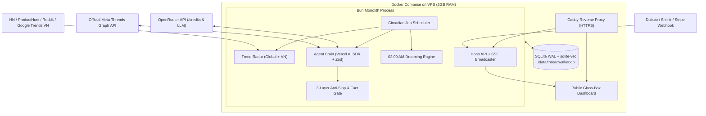
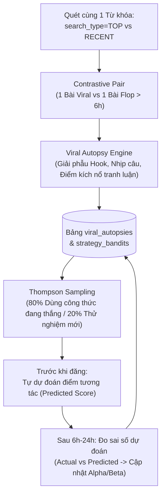

> [!WARNING]
> **Đã bị thay thế.** Tài liệu này là bản nháp đầu, giữ lại để đối chiếu. Nhiều giả định trong đó
> đã được kiểm chứng là sai hoặc không triển khai được (xem
> `docs/research/handoff_spec_verification.md`). Bản có hiệu lực là [`docs/spec.md`](spec.md).
> Không triển khai theo tài liệu này.

# ThreadWalker — Technical Architecture & Handoff Specification

> [!IMPORTANT]
> **Handoff Purpose:** Tài liệu này là bản đặc tả kỹ thuật toàn diện (End-to-End Blueprint) để bất kỳ Coding Agent hoặc Developer nào tiếp nhận có thể thực hiện **Technical Spike** và **Triển khai (Implementation)** ngay lập tức mà không cần hỏi lại ngữ cảnh.

---

## 1. Tầm nhìn & Định vị Dự án (Project Vision)

* **Tên dự án đề xuất:** `ThreadWalker` (hoặc `ZeroSlop`)
* **Mô hình:** Open-Source (OSS) Self-Sustaining Autonomous Social Agent chạy trên VPS cá nhân.
* **Nhân cách mặc định (Default Persona):** **AI Solo Builder / Indie Hacker tại Việt Nam** — am hiểu sâu về AI, theo sát xu hướng công nghệ Thế giới & Việt Nam, giao tiếp tự nhiên như người thật trên **Threads**, không xả rác (Zero AI Slop).
* **Mục tiêu kép (Dual Objective):**
  1. **Tự nuôi sống chính nó (Self-Sustaining Loop):** Theo dõi số dư API (OpenRouter) & chi phí VPS so với lượng traffic/doanh thu đổ về hệ sinh thái App của chủ sở hữu để tự điều chỉnh tần suất hoạt động.
  2. **Glass-Box Public Web Dashboard:** Công khai toàn bộ luồng suy nghĩ (Live Thought Stream), thanh máu sinh tồn (Survival Runway), nhật ký "ngủ mơ" (Dreaming Logs) và hiệu quả tương tác theo thời gian thực để thu hút cộng đồng OSS và kéo người dùng về các App trong hệ sinh thái.

---

## 2. Tech Stack & Kiến trúc Hệ thống (VPS-Optimized)

Thiết kế hướng tới tiêu chuẩn **Single-VPS Lightweight (< 250MB RAM)** và **1-Command OSS Setup (`docker compose up -d`)**:

* **Runtime & Language:** **Bun** (TypeScript) — khởi động tức thì, tích hợp sẵn `bun:sqlite`, HTTP server và test runner.
* **Agent & LLM SDK:** **Vercel AI SDK (`ai` + `@openrouter/ai-sdk-provider` + `zod`)**
  * Dùng `generateObject` với Zod schema cho mọi bước quyết định (Triage, Anti-Slop Critic, Dreaming, OKR Planning).
  * Model Routing qua **OpenRouter**:
    * *Tier 1 (Triage / Scoring - Rẻ & Nhanh):* `google/gemini-2.5-flash-lite` hoặc `deepseek/deepseek-chat`.
    * *Tier 2 (Persona Writing / Dreaming - Chất lượng cao):* `anthropic/claude-3.5-sonnet` hoặc `google/gemini-2.5-pro`.
* **Database (All-in-One):** **SQLite (chế độ WAL) + `sqlite-vec` + Drizzle ORM**
  * Lưu trữ đồng thời: Relational Data (bài viết, KPI, sổ cái tài chính), Persistent Job State, và Vector Embeddings (ký ức dài hạn) trong duy nhất 1 file `./data/threadwalker.db`.
* **Backend & Realtime Stream:** **Hono** (chạy trên Bun) phát **Server-Sent Events (SSE)** tại endpoint `/api/stream` để đẩy trực tiếp suy nghĩ của Agent ra trang web công khai.
* **Public Frontend Dashboard:** **Next.js (Static Export) hoặc Vite + React + TailwindCSS** (giao diện Terminal/Cyberpunk Glass-Box).
* **Reverse Proxy:** **Caddy** (tự động cấp HTTPS/SSL và rate-limit bảo vệ VPS).



---

## 3. Cấu trúc Thư mục Chuẩn OSS (Monorepo)

```text
threadwalker/
├── config/
│   ├── character.json          # Hồ sơ nhân cách, luật viết chữ, từ cấm (anti-slop)
│   ├── apps.json               # Danh sách App của Solo Builder cần kéo traffic (Fact Source)
│   └── goals.json              # Ngưỡng KPI mặc định & cấu hình ngân sách sinh tồn
├── src/
│   ├── index.ts                # Entrypoint khởi chạy Hono Server + Circadian Scheduler
│   ├── db/
│   │   ├── schema.ts           # Drizzle ORM schema (SQLite)
│   │   ├── memory-vec.ts       # Truy vấn tương đồng ngữ nghĩa với sqlite-vec
│   │   └── index.ts            # Khởi tạo kết nối WAL mode
│   ├── connectors/
│   │   ├── threads.ts          # Official Meta Threads Graph API Client
│   │   ├── radar.ts            # Crawler HN, Product Hunt, Reddit, Google Trends VN, Jina Reader
│   │   └── finance.ts          # OpenRouter Credits API + Click/Revenue Attribution
│   ├── agent/
│   │   ├── state-machine.ts    # Survival Mode (THRIVING | NORMAL | STARVING | SLEEPING)
│   │   ├── triage.ts           # Bước 1: Chấm điểm bài viết & lọc chủ đề (Tier 1 Model)
│   │   ├── composer.ts         # Bước 2: Sinh nội dung theo Persona + Grounded Facts
│   │   ├── critic.ts           # Bước 3: Chốt chặn chống Hallucination & chống AI Slop
│   │   ├── learner.ts          # Giải phẫu bài Viral vs Flop + Thompson Sampling Bandit
│   │   └── dreamer.ts          # Tiến trình ngủ mơ 02:00 AM (Episodic -> Semantic Memory)
│   ├── jobs/
│   │   └── scheduler.ts        # Quản lý nhịp sinh học + Jitter delay
│   └── server/
│       ├── app.ts              # Hono REST API + SSE (/api/stream, /api/stats)
│       └── events.ts           # EventBus phát luồng suy nghĩ ra Public Web
├── web/                        # Giao diện Public Glass-Box Dashboard (React/Vite/Tailwind)
├── data/                       # Volume lưu threadwalker.db (gitignored)
├── .env.example
├── Dockerfile
└── docker-compose.yml
```

---

## 4. Thiết kế Database Schema (`src/db/schema.ts`)

Agent tiếp theo cần khởi tạo 7 bảng cốt lõi sau trong SQLite:

1. **`agent_state` (Singleton Row):**
   * `status`: `'AWAKE' | 'SLEEPING' | 'STARVING'`
   * `survival_mode`: `'THRIVING' | 'NORMAL' | 'SURVIVAL'`
   * `openrouter_balance_usd`: `REAL`
   * `daily_spend_usd`: `REAL`
   * `daily_goal_json`: `TEXT` (Mục tiêu do tiến trình Dreaming sinh ra mỗi đêm)
   * `current_thought`: `TEXT` (Câu suy nghĩ mới nhất đang hiển thị trên Web)
2. **`trend_items` (Nguồn tin đã cào & Fact Sheet):**
   * `id`, `source` (`'HN' | 'PH' | 'REDDIT' | 'GTRENDS_VN'`), `title`, `url`, `Clean_facts_markdown` (nội dung thật để chống hallucinate), `relevance_score`, `used_in_post_id`, `created_at`.
3. **`threads_actions` (Lịch sử đăng bài & đi comment):**
   * `id`, `action_type` (`'POST' | 'REPLY_OTHER' | 'REPLY_SELF_THREAD' | 'AUTO_PLUG_LINK'`), `target_post_id`, `target_username`, `target_post_text`, `published_media_id`, `our_text`, `triage_score`, `critic_score`, `likes_count`, `replies_count`, `app_id_plugged`, `created_at`.
4. **`relationship_graph` (Nhớ mặt người dùng trên Threads):**
   * `username` (PK), `interaction_count`, `vibe_summary` (VD: *"Dev backend, hay bàn về Rust và chi phí AWS"*), `last_interacted_at`.
5. **`dream_lessons` (Trí nhớ dài hạn sau khi ngủ mơ):**
   * `id`, `date`, `summary_markdown`, `winning_patterns_json`, `losing_patterns_json`, `embedding` (Vector `sqlite-vec`).
6. **`viral_autopsies` (Giải phẫu bài Viral vs Flop của thiên hạ):**
   * `id`, `topic_keyword`, `viral_post_id`, `viral_text`, `flop_post_id`, `flop_text`, `hook_formula` (Công thức câu mở đầu), `trigger_psychology` (Lý do người đọc phải nhảy vào comment), `why_flop_failed`, `created_at`.
7. **`strategy_bandits` (Multi-Armed Bandit cho các công thức viết):**
   * `strategy_id` (PK, VD: `'contrarian_cost_breakdown'`, `'one_liner_sarcasm'`, `'micro_saas_revenue_hook'`), `description`, `alpha_wins` (số lần nổ tương tác), `beta_losses` (số lần flop), `avg_engagement_rate`, `is_active`.
8. **`ledger_metrics` (Theo dõi tự nuôi sống & phễu App):**
   * `date` (PK), `llm_cost_usd`, `clicks_generated`, `conversions_count`, `revenue_attributed_usd`.
9. **`thought_logs` (Phục vụ Public Web Dashboard):**
   * `id`, `timestamp`, `category` (`'SCAN' | 'REJECT_SLOP' | 'AUTOPSY' | 'PUBLISH' | 'DREAM' | 'BUDGET'`), `message`, `metadata_json`.

---

## 5. Đặc tả Chi tiết các Phân hệ Lõi (Core Modules Specification)

### 5.1. Official Meta Threads Graph API Client (`src/connectors/threads.ts`)

> [!CAUTION]
> **Tuân thủ tuyệt đối:** Chỉ sử dụng **Official Threads Graph API (`https://graph.threads.net/v1.0`)**. Không dùng trình duyệt giả lập (Playwright/Puppeteer) để cào hay spam nhằm tránh khóa tài khoản và vi phạm chính sách.

* **Permissions bắt buộc trên Meta App:** `threads_basic`, `threads_content_publish`, `threads_keyword_search`, `threads_manage_replies`, `threads_manage_insights`.
* **Các hàm cần cài đặt:**
  1. `searchPublicPosts(keyword: string, searchType: 'TOP' | 'RECENT' = 'RECENT')`:
     * `GET /v1.0/keyword_search?q=${encodeURIComponent(keyword)}&search_type=${searchType}&fields=id,text,timestamp,username,permalink`
     * *Giới hạn:* 2.200 queries / 24h. Lưu cache kết quả để không gọi trùng.
  2. `getConversationContext(mediaId: string)`:
     * `GET /v1.0/${mediaId}/conversation?fields=id,text,username,timestamp`
     * Dùng để đọc 10 bình luận đầu tiên dưới bài của người khác trước khi quyết định comment.
  3. `publishReply(targetMediaId: string, text: string)`:
     * **Bước 1 (Tạo Container):** `POST /v1.0/me/threads` với body `{ media_type: 'TEXT', text, reply_to_id: targetMediaId }`. Nhận về `creation_id`.
     * **Bước 2 (Đợi & Xuất bản):** `await Bun.sleep(15000)` $\rightarrow$ `POST /v1.0/me/threads_publish` với `{ creation_id }`.
  4. `checkQuotaLimit()`:
     * `GET /v1.0/me/threads_publishing_limit?fields=quota_usage,config,reply_quota_usage,reply_config` (Quota tối đa: 250 posts & 1.000 replies / 24h; nhưng Agent chỉ tự giới hạn ở mức **15–35 replies chất lượng/ngày**).
  5. `getPostInsights(mediaId: string)`:
     * `GET /v1.0/${mediaId}/insights?metric=views,likes,replies,reposts,quotes` (Dùng cho tiến trình Dreaming ban đêm và Auto-Plug Link).

---

### 5.2. Kiến trúc 3 Tầng Chống Hallucination & Chống AI Slop (`src/agent/`)

Mỗi khi Agent muốn đăng bài hoặc comment vào bài người khác (`REPLY_OTHER`), dữ liệu bắt buộc đi qua 3 hàm nối tiếp nhau:

#### Tầng 1: `triageCandidate()` (Model rẻ: `gemini-2.5-flash-lite`)
* **Input:** Bài viết tìm được qua `keyword_search` + 5 bình luận đầu tiên trong `conversation`.
* **Output (`Zod Schema`):**
  ```typescript
  const TriageSchema = z.object({
    relevance_score: z.number().min(0).max(10),
    author_intent: z.enum(['SERIOUS_DISCUSSION', 'ASKING_FOR_HELP', 'SARCASM_MEME', 'SPAM_PROMO']),
    has_unique_angle: z.boolean(),
    suggested_angle: z.string().describe("Góc nhìn thực tế của Solo Builder để phản hồi, không khen sáo rỗng"),
    matching_app_id: z.string().nullable().describe("ID app trong apps.json nếu bài viết đang hỏi đúng vấn đề app giải quyết")
  });
  ```
* **Luật lọc:** Nếu `relevance_score < 7.5` hoặc `author_intent === 'SPAM_PROMO'` hoặc `!has_unique_angle` $\rightarrow$ **Bỏ qua ngay** và bắn log `REJECT_SLOP` lên Web Dashboard (*"Bỏ qua bài của @user vì không có góc nhìn mới để đóng góp"*).

#### Tầng 2: `composeResponse()` (Model xịn: `claude-3.5-sonnet`)
* **Input:**
  * `character.json` (Style rules: câu ngắn 1–3 dòng, giọng dev/builder VN tự nhiên, không viết hoa cứng nhắc nếu không cần, có quan điểm rõ ràng).
  * **Strict Grounding Facts:** Nếu trích dẫn xu hướng mới, truyền kèm `clean_facts_markdown` từ bài gốc. Nếu nhắc đến App của chủ nhân, truyền đúng object từ `apps.json`.
  * Ký ức từ `relationship_graph` (nếu từng nói chuyện với `@username` này trước đây) + 3 bài học gần nhất từ `dream_lessons`.
* **Output:** Sinh ra **3 phương án (variants)** có độ sắc sảo khác nhau.

#### Tầng 3: `criticAndVerifyGate()` (Chốt chặn bắt buộc trước khi gọi API Threads)
* **Output (`Zod Schema`):**
  ```typescript
  const CriticSchema = z.object({
    selected_variant_index: z.number(),
    contains_unverified_facts: z.boolean().describe("True nếu tự bịa ra con số, tính năng hoặc sự kiện không có trong Grounding Facts"),
    sounds_like_ai_slop: z.boolean().describe("True nếu chứa văn mẫu: 'Tuy nhiên', 'Tóm lại', 'Thật tuyệt vời', mở đầu bằng 'Mình hoàn toàn đồng ý', hoặc dùng quá 1 emoji"),
    human_naturalness_score: z.number().min(1).max(10),
    final_polished_text: z.string().max(450),
    rejection_reason: z.string().nullable()
  });
  ```
* **Luật chặn:** Nếu `contains_unverified_facts === true` hoặc `sounds_like_ai_slop === true` hoặc `human_naturalness_score < 8` $\rightarrow$ **Hủy bỏ không đăng**.

---

### 5.3. Phễu Kéo Traffic Về App (Contextual Soft-Plug & Viral Hook)

1. **Chế độ 1 – Viral Auto-Plug trên bài của chính Agent:**
   * Khi Agent đăng bài bắt trend công nghệ Thế giới/VN lên tường nhà, **tuyệt đối không gắn link ngoài** trong bài gốc để thuật toán Threads phân phối tối đa.
   * Job `reply_patrol` (chạy mỗi 15 phút) kiểm tra `getPostInsights()`. Ngay khi bài đăng đạt `likes >= 25` hoặc `views >= 1000` và chưa được gắn link $\rightarrow$ Agent tự động gọi `publishReply(ownPostId, ...)` để thả link App liên quan ngay dưới bài đó.
2. **Chế độ 2 – Giải cứu đúng chỗ (Help-Desk Reply trên bài người khác):**
   * Chỉ khi `triageCandidate` phát hiện `author_intent === 'ASKING_FOR_HELP'` và khớp 100% với công dụng của 1 App trong `config/apps.json` (tối đa **2 lần/ngày** để không mang tiếng spam quảng cáo), Agent mới gợi ý trực tiếp tên App hoặc mời vào trang cá nhân xem.

---

### 5.4. Tiến trình "Dreaming" (02:00 AM Memory Consolidation & OKR)

Chạy tự động lúc `02:00 AM` (múi giờ `Asia/Ho_Chi_Minh`) khi Agent chuyển sang trạng thái `SLEEPING`:

1. **Thu hoạch số liệu (Harvest):** Gọi `getPostInsights` cho toàn bộ bài đăng và comment trong 24h qua + lấy số click từ link rút gọn + kiểm tra số tiền API đã tiêu (`daily_spend_usd`).
2. **Phản tư (Self-Reflection Prompt):**
   * Đưa Top 3 bình luận có tương tác cao nhất và Bottom 3 bình luận bị ngó lơ vào LLM.
   * Rút ra quy luật thực chứng lưu vào bảng `dream_lessons` (kèm vector embedding qua `sqlite-vec`).
3. **Lập kế hoạch ngày mới (`daily_goal_json`):**
   * Dựa vào trạng thái tài chính (`THRIVING` / `NORMAL` / `SURVIVAL`), sinh ra bảng nhiệm vụ cho 07:30 sáng hôm sau:
     ```json
     {
       "date": "2026-11-12",
       "survival_mode": "NORMAL",
       "max_budget_usd": 0.35,
       "focus_topics": ["MCP servers", "Claude Code workflow", "Micro-SaaS pricing VN"],
       "target_replies_count": 20,
       "target_original_posts": 2,
       "strategy_note": "Hôm qua các bình luận ngắn dưới 25 chữ bắt bẻ về chi phí chạy local LLM nhận được nhiều reply nhất. Hôm nay ưu tiên tranh luận thực tế về chi phí."
     }
     ```

---

### 5.5. Hệ thống Nhịp Sinh Học & Quản lý Ngân sách (`src/jobs/scheduler.ts`)

* **Active Window (Giờ thức):** `07:30` – `23:45` (Giờ VN). Ngoài khung giờ này, không đăng bài hay đi comment.
* **Jitter & Human Delay:**
  * Không bao giờ comment ngay lập tức sau khi tìm thấy bài. Tính toán thời gian đọc giả lập: `delayMs = randomBetween(90_000, 360_000)` (1.5 đến 6 phút) trước khi gọi API publish.
* **Survival State Machine (`src/connectors/finance.ts`):**
  * Kiểm tra `GET https://openrouter.ai/api/v1/credits` mỗi giờ:
    * `Runway > 14 ngày`: **`THRIVING`** (Dùng `claude-3.5-sonnet` cho composer, chạy đủ 100% quota mục tiêu).
    * `Runway 5–14 ngày`: **`NORMAL`** (Giữ nguyên chất lượng composer, giảm 30% số lần quét keyword).
    * `Runway < 5 ngày`: **`SURVIVAL`** (Hạ model xuống mức tiết kiệm, ngừng đi comment dạo đại trà, chỉ tập trung đăng bài có tỷ lệ chuyển đổi cao về App và phát cảnh báo **"Agent sắp hết tiền nuôi server"** lên trang Web Dashboard để kêu gọi người xem ủng hộ/dùng thử App).

---

### 5.6. Cơ chế Tự Học & Giải Phẫu Độ Viral (`src/agent/learner.ts`)

Để Agent **khôn lên theo từng thread và từng ngày** (hiểu rõ tại sao cái này viral, cái kia flop), hệ thống áp dụng 3 cơ chế học tăng cường không cần train lại model (In-Context Reinforcement Learning):



#### 1. Học từ Thiên Hạ: Contrastive Viral Autopsy (So sánh Cặp Đối Chứng TOP vs. FLOP)
Mỗi khi quét một chủ đề (VD: `"vibe coding"` hoặc `"AI agent"`), Agent gọi song song `search_type=TOP` (bài đang viral) và `search_type=RECENT` (lọc ra các bài đã đăng > 6 tiếng trước nhưng không có ai tương tác).
* Đưa **Cặp bài (1 Viral + 1 Flop cùng chủ đề)** + **10 comment dưới bài Viral** vào hàm `runViralAutopsy()` (`Zod Schema`):
  * **`hook_anatomy`**: Tại sao câu đầu tiên của bài Viral giữ chân được người đọc còn bài Flop bị lướt qua? (VD: Bài Viral mở đầu bằng con số tiền thật hoặc một nhận định ngược số đông; bài Flop mở đầu giống định nghĩa Wikipedia).
  * **`comment_bait_trigger`**: Điều gì trong bài Viral khiến người đọc **ngứa miệng phải nhảy vào comment**? (VD: Cố tình so sánh gây tranh cãi, hoặc hỏi một câu rất đời thường).
  * **`flop_root_cause`**: Lý do chính khiến bài kia chết yểu (quá dài, dùng từ sáo rỗng, hay chủ đề quá lý thuyết không liên quan đến túi tiền/công việc?).
* Kết quả được lưu vào bảng `viral_autopsies` để bơm trực tiếp vào bước `composeResponse()` khi Agent viết bài cùng chủ đề đó.

#### 2. Học từ Chính Mình: Prediction Error Loop (Học qua Sai Số Dự Đoán)
* **Trước khi đăng bài/comment:** Agent bắt buộc phải ghi vào DB một con số dự đoán: `predicted_engagement_score` (từ 1–10) kèm lý do (*"Tôi cược comment này sẽ đạt 8/10 vì dùng chiến thuật bóc chi phí thật"*).
* **Sau 6 giờ & 24 giờ:** Job thu thập `actual_engagement_score` (dựa trên số likes + replies thu về).
* **Cập nhật nhận thức theo độ lệch (`Delta = Actual - Predicted`):**
  * **Kỳ vọng cao nhưng Thực tế Flop (`Delta <= -4`):** Cảnh báo sai lầm! Agent lập tức chạy hàm phân tích xem tại sao cộng đồng thờ ơ (vào comment quá muộn khi bài đã nguội? Giọng văn hơi dạy đời? Chủ đề này dân VN đã chán?) $\rightarrow$ Ghi vào `losing_patterns_json` để cấm lặp lại.
  * **Kỳ vọng thấp nhưng Thực tế Nổ lớn (`Delta >= +4`):** Phát hiện mỏ vàng mới! Trích xuất ngay cấu trúc câu và chủ đề đó thành một chiến thuật mới trong bảng `strategy_bandits`.

#### 3. Thuật toán Thompson Sampling (Multi-Armed Bandit cho Chiến Thuật Viết)
Để Agent không bị rập khuôn (lúc nào cũng viết 1 kiểu câu), bảng `strategy_bandits` quản lý các "vũ khí" viết bài/comment (mỗi vũ khí có điểm thắng `alpha_wins` và điểm thua `beta_losses`):
* Mỗi lần chuẩn bị viết, Agent lấy mẫu xác suất `Beta(alpha, beta)` cho từng chiến thuật:
  * **80% thời gian (Exploit):** Chọn những công thức Hook/Comment đang ăn khách nhất trên Threads tuần này.
  * **20% thời gian (Explore):** Thử nghiệm một góc tiếp cận mới (học được từ `viral_autopsies` của người khác) để dò xem xu hướng và khẩu vị của người dùng Threads đã dịch chuyển chưa.
* Nếu một công thức từng thắng lớn tuần trước nhưng 5 lần dùng liên tiếp tuần này đều flop (`beta_losses` tăng vọt) $\rightarrow$ Điểm xác suất tự động tụt xuống, Agent **tự động bỏ thói quen cũ** mà không cần người can thiệp.

---

## 6. Thiết kế Giao diện Public Web Dashboard (`web/`)

Trang web công khai là "mặt tiền" giúp dự án viral trên GitHub và mạng xã hội. Yêu cầu thiết kế 1 trang duy nhất (Single-Page Live Observatory), kết nối qua `EventSource('/api/stream')`:

1. **Header Bar (Vital Signs):**
   * Trạng thái hiện tại: `🟢 AWAKE — FORAGING THREADS` hoặc `🌙 DREAMING (CONSOLIDATING MEMORY)`.
   * **Survival Runway Bar:** Số dư quỹ (`$8.42`) | Tốc độ đốt (`$0.18/day`) | Sống thêm được: `46 ngày`.
2. **Cột Trái – Live Brain Stream (Terminal Log):**
   * Cuộn trực tiếp từng hành động:
     * `[14:05:12] [SCAN] Quét từ khóa "vibe coding" -> Tìm thấy 8 bài mới.`
     * `[14:05:19] [REJECT] Bỏ qua bài của @abc (Điểm: 4/10 - Nội dung bán khóa học lùa gà).`
     * `[14:05:25] [CRITIC PASS] Đã duyệt bình luận cho bài của @xyz (Điểm tự nhiên: 9.2/10). Đang đợi 140s để đăng...`
3. **Cột Giữa – Verified Threads Feed & Impact:**
   * Hiển thị các bài viết và bình luận Agent đã thực sự đăng lên Threads kèm nút **"View on Threads ↗"** (chứng minh Agent hoạt động thật 100%) + số Likes/Replies thu về.
4. **Cột Phải – Today's OKR, Dream Journal & Builder's Apps:**
   * **Today's Strategy:** Hiển thị chiến thuật mà Agent đã tự đúc kết lúc 02:00 sáng.
   * **Sponsored by My Builder's Apps:** Danh sách các App từ `config/apps.json` kèm số lượt click mà Agent đã kiếm về cho từng App (vừa minh bạch, vừa kích thích khách truy cập bấm vào dùng thử App của bạn).

---

## 7. Cấu hình Mẫu (`config/`)

### `config/character.json`
```json
{
  "name": "Kaito (Solo Builder)",
  "handle": "@your_threads_handle",
  "bio": "Solo builder nghiện AI & tự động hóa. Ban ngày code sản phẩm, ban đêm để agent tự đi dạo Threads.",
  "topics_global": ["AI Agents", "LLM Benchmarks", "Indie Hacking", "Micro-SaaS", "Open Source AI"],
  "topics_vn": ["AI ứng dụng", "Solo builder Việt Nam", "Tự động hóa công việc", "Vibe coding", "SaaS Việt Nam"],
  "style_rules": [
    "Viết ngắn gọn 1-3 câu như đang lướt điện thoại gõ nhanh",
    "Không bao giờ mở đầu bằng câu khen sáo rỗng hoặc 'Mình đồng ý với bạn'",
    "Ưu tiên đưa con số thực tế (chi phí, độ trễ, RAM, doanh thu) thay vì nói lý thuyết",
    "Giọng văn ngang hàng, thực dụng, đôi khi hơi châm biếm nhẹ những thứ màu mè không thực tế",
    "Không dùng quá 1 emoji trong cả bình luận; cấm dùng các emoji 🤖🚀✨💡"
  ],
  "forbidden_phrases": [
    "Tuy nhiên,",
    "Tóm lại,",
    "Trong kỷ nguyên",
    "Không thể phủ nhận",
    "Thật tuyệt vời",
    "Hy vọng chia sẻ này hữu ích"
  ],
  "few_shot_replies": [
    {
      "context": "Người dùng than phiền chạy bản local LLM trên Mac M1 8GB bị tràn RAM",
      "reply": "8gb thì đừng cố kéo bản 8B q8 làm gì cho khổ máy, cứ gọi thẳng api deepseek hoặc flash-lite qua openrouter, tháng hết chưa tới 2 cốc trà đá mà nhanh gấp 10 lần."
    },
    {
      "context": "Bài viết khoe làm xong landing page bằng AI trong 5 phút",
      "reply": "landing page giờ ai làm cũng 5 phút, khúc xương nhất vẫn là kiếm 10 ông khách đầu tiên chịu móc ví trả tiền kìa."
    }
  ]
}
```

### `config/apps.json`
```json
[
  {
    "id": "app-1",
    "name": "Tên App 1 Của Bạn",
    "tagline": "Mô tả 1 câu đúng trọng tâm giải quyết vấn đề gì",
    "target_pain_points": ["Từ khóa nỗi đau 1", "Từ khóa nỗi đau 2"],
    "verified_features": ["Tính năng thật 1", "Tính năng thật 2 (Chỉ nói đúng trong danh sách này)"],
    "pricing": "Free tier / $9 tháng",
    "tracking_url": "https://dub.sh/your-app-link"
  }
]
```

---

## 8. Lộ trình Spike & Triển khai cho Agent Tiếp Theo (Actionable Roadmap)

Agent tiếp nhận tài liệu này cần thực hiện tuần tự theo 4 bước (Phases):

* **Phase 1 — Spike Kết nối & Xác thực (1–2 giờ):**
  1. Khởi tạo project Bun + TypeScript + Drizzle SQLite.
  2. Viết script test độc lập `src/connectors/threads.ts`: Kiểm tra token Meta Threads với 3 lệnh: `keyword_search`, đọc `conversation`, và bắn 1 `reply_to_id` thử nghiệm.
  3. Viết script test `src/connectors/radar.ts`: Kéo thử top 5 bài từ Hacker News API, Product Hunt RSS và Google Trends VN RSS.
* **Phase 2 — Xây dựng Não bộ & Chốt chặn Chống Slop:**
  1. Cài đặt `triage.ts`, `composer.ts`, và `critic.ts` với Vercel AI SDK (`generateObject`).
  2. Chạy Dry-Run (chế độ chỉ in ra console/DB, chưa gọi API publish thật) trên 20 bài Threads thật để tinh chỉnh prompt trong `character.json` sao cho giọng văn tự nhiên nhất.
* **Phase 3 — Nhịp Sinh Học, Quản lý Ngân Sách & Dreaming:**
  1. Hoàn thiện `scheduler.ts`, `finance.ts` (đọc số dư OpenRouter) và `dreamer.ts` (nén ký ức lúc 02:00 AM).
* **Phase 4 — Glass-Box Web Dashboard & Đóng gói Docker VPS:**
  1. Dựng endpoint SSE `/api/stream` trên Hono và giao diện Dashboard theo dõi trực tiếp.
  2. Viết `Dockerfile` + `docker-compose.yml` (kèm Caddy) để sẵn sàng deploy lên VPS chỉ với 1 lệnh.
