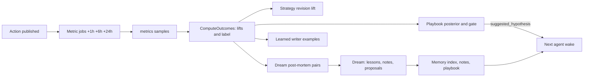

# Learning: what does the agent remember, how does code measure outcomes, and what changes the playbook?

Feedback is delayed and noisy at tens of actions a day: the research estimates about 49 days to separate a 20% strategy from a 30% one across five arms, so single posts teach little. Code counts outcomes; the agent never counts its own results. The agent may add or amend single playbook entries, never rewrite the playbook wholesale (wholesale rewriting once collapsed an agent's context from 18,282 to 122 tokens). The template and system prompt are immutable to the agent.

## Loop

## What the agent keeps

| Store | Tools | Bounds |
|---|---|---|
| Memory index | `memory_add`, `memory_supersede` | Entry at most 500 characters and 5 lines. Index at most 60 lines and 6 KiB of live entries (`TestMemoryIndexBudgetMeasurement`: the byte cap binds first, leaving 45 entries of about 130 bytes, or 4 of the longest allowed). The only memory loaded into a wake, each live entry shown with its `id`. Written by the dream only |
| Notes | `note_write`, `note_search`, `note_read` | Topic at most 64 characters on one line, description at most 200. A wake loads only the topic list (name and description, newest written first, at most 40 topics and 2,000 characters), never a body. Memory entries, topics and recalled notes load only in the mode (dry-run or live) they were written in: a row takes the mode of the agent's latest action at or before its `created_at`, else of its first action, else the current mode. A row written after a mode change and before the next action takes the old mode |
| Playbook | `playbook_read`, `playbook_propose` | Hypotheses `testing`, `established`, `rejected`; below |
| Strategy | `strategy_write` | At most 2000 characters; below |
| Contacts | `mark_do_not_contact` | Add-only ([guards.md](guards.md)) |
| Craft knowledge | `knowledge_read`, `knowledge_candidate` | Below |

Memory holds strategy and facts about the agent's own content, never details about a Threads user; text taken from Threads stays in the data message.

### Memory index rules

| Rule | Fact |
|---|---|
| Overflow | An entry that would overflow either budget archives the oldest live entries in the same transaction as the insert, so an entry is always in the index or the archive |
| Duplicates | An entry identical to a live one is dropped |
| Expiry | An entry ending ` · until YYYY-MM-DD` is archived by code at the start of the next wake after that date |
| Supersede | Dream only. `old_id` < `new_id`, both live; one wake supersedes at most a fifth of the entries it started with, at least one |
| Journal | Every add, overflow archive, expiry, supersede and restore writes a `memory_journal` row (old text, new text, wake id, phase). No tool reads or writes it. The dashboard shows the newest 30; `ctl memory restore <journal-id> --agent ID` puts an archived entry back as a new live one (an expired entry is refused); Telegram `/restore` lists the last 5 and restores one by `m<id>` |
| Secrets | A call carrying a configured secret is refused before any write |
| Dream lessons | Must cite exactly one own `action_id` and pass the lesson gate ([wake.md](wake.md)) |

### Note search and recall

| Item | Fact |
|---|---|
| Ranking | `note_search` merges two rankings of the agent's own notes and actions (posts and replies) by reciprocal rank fusion (`1/(60+rank)` summed, ties to the newest) over the top 100 of each, with optional `since` and `until`: SQLite FTS5 BM25, and brute-force cosine of the query embedding against the agent's stored vectors. Hits found only by meaning show the first 160 characters instead of a marked snippet |
| Query | Split into quoted terms joined with OR in code, never passed raw to `MATCH` |
| Refs | `note_search` returns `ref` + snippet; `note_read` returns the full text for a ref or `topic:<topic>` |
| Tokenizer | `unicode61 remove_diacritics 0` (`TestTokenizerMeasurement` in `internal/store`: on a 28-text, 8-query Vietnamese set, precision 0.875 vs 0.535 for `2` at equal recall on accented queries; recall 0.562 vs 1.000 on unaccented ones) |
| Embeddings | Each note and own action embedded once with OpenAI `text-embedding-3-large` at the full 3,072 dimensions, using `OPENAI_API_KEY` (required at template load, a `Secret`, redacted). Stored as a float32 blob in `embeddings`, keyed by source, row id and SHA-256 of the text, so identical text is embedded once and changed text again. Trend stories and Threads observations are never embedded |
| Write path | A write embeds the rows it added (`note_write`, `post`, `reply`); startup embeds any row still missing a vector through the same function. A failed embed leaves the row pending and never fails the write |
| Spend | Recorded in the ledger under the phase of the triggering wake and counted toward that phase's cap; the startup backfill has no wake and bills phase `agent` against `limits.max_usd_per_day` |
| Fallback | If the query cannot be embedded (request failure, cap reached) the call ranks by BM25 alone and logs `embedding.failed` with the reason. Offline runs and evals use a deterministic in-process embedder on the same path |
| Recall | Before each wake code runs that search once, with a query joined from the brief's rising keywords, the texts of playbook entries under test and the newest own actions, and adds at most 6 snippets under 4 KiB as a `recalled_memory` user message labelled as data (redacted, own agent only; actions already in the data message and the memory index are never recalled). Empty memory or a failed search adds nothing; an embedding failure falls back to BM25 |
| Measured | 48-note, 30-query Vietnamese set (`TestMemoryRecall_HybridBeatsBM25OnRecordedEmbeddings`; gated `TestMemoryRecall_LiveEmbeddings` in `internal/tools`): recall@5 0.917 hybrid vs 0.783 FTS5 alone; cosine alone 0.950 for `-3-large`, 0.883 at 256 dimensions, 0.817 for `-3-small`. Embedding the set costs under $0.001 |

## Playbook

| Rule | Fact |
|---|---|
| Entries | At most 15 `testing`. Seeds initialize once per agent with a durable marker; a restart never restores removed or edited seed text. Amending genuinely changed testing text increments the revision and resets counters. Decided entries are immutable. `playbook_propose` may cite a curated `knowledge_id` |
| Tagging | The agent tags an action with up to 5 hypotheses it is testing. The guard snapshots each tagged own testing revision in the same transaction as the intent; unknown, foreign, decided, duplicate or more than five ids are refused (`invalid_hypothesis`) |
| Counting | Only own confirmed non-dry-run actions with a completed harness-owned 24-hour target linked to its stored sample, measured in **[24h, 30h]** inclusive. Zero views, missing metrics, earlier windows and later catch-up supply no evidence. An outcome counts at most once for its original revision; markers, counters and decisions commit atomically; restart reconciles committed metrics without replaying actions |
| Control | Untagged actions are the control: a tagged action's lift is already measured against what its hour, kind and context predicted |
| Kind binding | A revision binds to the kind (`post` or `reply`) of its first counted action (`playbook.kind`); the other kind adds nothing (`kind_mismatch`) |

**Posterior.** Combined lift of a counted action: `(reach lift + resonance lift) / 2`, read from `action_outcomes`. The mean lift has a normal posterior (one shared variance). Prior: weight of 8 actions, centred on 0 plus the mean lift of the other hypotheses of the same kind, shrunk toward 0 with the weight of 20 actions (a revision with no counted action has centre 0). Shared variance: pooled variance of all counted lifts with a prior of 4 degrees of freedom at variance 1. Computed on demand from stored lifts; no counter other than `n` is kept.

**Decisions** (code, after each counted action; `δ` is `learning.min_effect`, default 0.2 on the log scale, about +22% over predicted):

| Decision | Condition | Reason code |
|---|---|---|
| `established` | P(mean lift > δ) >= 0.95 with at least 8 counted actions | |
| `rejected` | P(mean lift < 0) >= 0.95 with at least 8 counted actions | `negative_evidence` |
| `rejected` | P(\|mean lift\| < δ) >= 0.9 after 30 counted actions | `no_effect` |
| stays `testing` | Everything else; the minimum of 8 also binds the negative rule | |

Decision, `n` and reason are stored in `playbook_decisions`.

**Exploration.** At the start of each normal wake code draws once from each `testing` posterior (Thompson sampling, runtime's injected random source) and puts the largest draw in the context as `suggested_hypothesis` with a reason. The agent may still tag freely. `explore: true` on `post`/`reply` tries something without a hypothesis; `limits.explore_percent` caps it ([guards.md](guards.md)). Stored as `actions.explore`.

The normal model, prior weights and thresholds are implementation choices, not a validated Threads learning algorithm. Establishment is observational: timing, topic and adaptive allocation confound the lift only partly removed.

**Synthetic measurement.** `internal/eval` runs the production posterior, decision and Thompson code: 5 hypotheses of one kind, the first with the stated true mean lift, lifts plus Student-t noise (3 degrees of freedom, scale 0.6, sd about 1.04), `δ` 0.2, at most 300 actions per hypothesis, 2000 runs per configuration.

| True lift | Result |
|---|---|
| 0 | False-establish rate per run 2.4%, 2.95%, 2.4% (seeds 101, 211, 307); per hypothesis 0.48%, 0.59%, 0.50% |
| 0.3 (seed 101) | 1365 of 2000 established, median 90 actions (p90 238); 140 rejected |
| 0.5 | 1991 of 2000 established, median 34 actions (p90 89) |

No paid call. Scaled down it runs in `go test`; full size is `internal/eval/testdata/learning.json`. These are synthetic, not engagement evidence; a wider real lift spread slows decisions.

## Strategy

`strategy_write` (any phase) stores the next version and replaces the one shown each wake: voice
notes, content pillars, signature formats and series, and which style rules were kept or dropped
and why. Every version stays in `strategy_revisions`.

Each revision cites 1 to 8 of the agent's own `action:<id>` or `note:<id>`. An uncited, malformed
or foreign citation writes nothing.

Per version the store reports the **lift**: the mean combined lift of live actions with a completed
24 hour outcome, comparing those posted between the previous revision and this one against those
posted after it until the next.

The template's style is the starting point; the strategy is memory. The dashboard shows the newest
10 revisions with their citations and a line diff. The owner undoes a bad revision with
`ctl strategy revert --agent ID [--to N]` or Telegram `/restore s<N>`, which writes the older text
again as a new revision with its own citations, so the history only grows. The dream proposes a
winning pattern as a hypothesis.

## Outcome model

Written by `ComputeOutcomes` ([`internal/metrics`](../internal/metrics)) after each metric batch and before the playbook counts. One `action_outcomes` row per own confirmed live action with a completed 24 hour sample that has views; stored once, never recomputed. The agent reads outcomes in wake and dream contexts (label, reach lift, resonance lift, followers per 1k views, rounded to two decimals) and writes none: every tool schema refuses `label`, `reach_lift`, `resonance_lift`, `applause_lift`, `followers_per_1k` and `model_version`.

| Item | Definition |
|---|---|
| Counters | One sample: views, likes, replies, reposts, quotes, shares, account followers, and for a reply `author_replied`. Followers are read through the guard and audit at the start of every agent wake and once per batch of claimed targets; the latest count at reservation is stored on the action. A counter the API did not return is absent, never zero. The replies count of an own reply comes from its direct replies, because insights reports 0 |
| Rates per view | Conversation = replies / views; amplification = (reposts + quotes + shares) / views; applause = likes / views. Without quotes or shares, amplification is unavailable and resonance uses conversation alone |
| Followers per 1k views | (followers at 24 h - followers at reservation) x 1000 / summed views of live measured actions posted from this action's time through the next 24 h, itself included. Unavailable if either follower count is |
| Axes | `log(1+views)`, `log((replies+0.5)/(views+1))`, `log((reposts+quotes+shares+0.5)/(views+1))`, `log((likes+0.5)/(views+1))` |
| Expected value | Log-linear model on context only: Huber-weighted iteratively reweighted ridge regression (20 iterations, Huber constant 1.345 on the MAD scale, ridge 1, intercept unpenalised). 18 terms: intercept; four-hour bucket of the posting hour in `schedule.timezone` (5); weekday (6); reply flag; for a reply `log(1+parent replies)` and `log(1+parent age in minutes)`; topic heat; `log(1+followers at reservation)`; `log(1+rolling median)` of 24 h views of the agent's actions in the prior 14 days. Topic heat: the highest brief heat among stories sharing two topic tokens with the text and rising keywords sharing one; 0 if none match or the brief is empty. Parent figures and topic heat come from what the wake read when the action's target or `trend_ref` was in its reads ([wake.md](wake.md)), else from stored observations; 0 if never observed |
| Fit schedule | Fit once at least 30 scored actions exist and the last fit is 24 h old; stored as the next version in `outcome_models` with row count and coefficients; an outcome records its version |
| Fallback | Under 30 scored actions, or no amplification rows: the median of that axis over the agent's same-kind actions of the previous 14 days. None: the outcome waits |
| Lift | `log(actual / expected)` per axis. Reach lift from views. Resonance lift = mean of conversation and amplification lifts. Applause lift is stored and shown but enters neither resonance nor a label |
| Labels | Over the agent's outcomes of the last 60 days by measurement time, this one included: `viral` = reach lift among the highest ceil(10% of n), ties included, and views at or above the 90th percentile; `flop` = reach and resonance lift both among the lowest ceil(25% of n); else `ordinary`. Under 20 outcomes everything is `ordinary` |

## Post-mortem

At the start of every dream, before the agent's turn, code builds the `post_mortem` block.

| Part | Rule |
|---|---|
| Pairs | From `viral` and `flop` actions of the last 14 days, each viral action takes the best-matching flop of the same kind; one pair per action, never across agents. Covariates: four-hour posting bucket, topic heat quintile (`min(4, floor(heat*5))`, 0 if unrecorded), and for a reply the parent tier (`floor(log10(1+parent replies))`). Exact = equal buckets and quintiles and tiers within one; exact first. Otherwise the nearest flop by summed bucket (wrapping at midnight), quintile and tier differences, with the distance reported. At most 5 pairs, `pair_id` `pm:<viral id>-<flop id>` |
| Content features | Computed in code per action: runes, lines, first line shares two topic tokens with a trend story seen in the prior 24 h, shares a run of three words with the observed parent, question mark, digit, near misses of `guard.blocked_phrases`, three-word runs shared with own actions of the prior 7 days. The block lists features on which the pair differs |
| Judge | With `review.llm`, that model rates each action 1 to 5 on hook strength, specificity, preachiness, slop-free, persona fit, target fit (rubric in [`internal/quality`](../internal/quality)); the parent post is untrusted data. It approves and blocks nothing. Billed to `dream` under `limits.max_usd_per_dream`; at the cap or on failure the rest go unscored with `judge_skipped` (`dream_cap`, `judge_failed`). Without `review.llm`: `not_configured`, no request |
| Attribution | Per pair on the log scale of the mean of views and resonance axes: `gap` = viral value minus flop value; `context_gap` = difference of expected values; `content_gap` = difference of stored lifts; they sum to `gap`. `explained_by` names the larger in absolute value. Lifts and labels are only read from `action_outcomes` |

## Metric jobs

| Rule | Fact |
|---|---|
| Seeding | Each own confirmed publication seeds durable targets at `posted_at` + 1 h, + 6 h, + 24 h. Dry-run and unconfirmed or unknown intents seed none; only actions of the last 29 days are seeded |
| Scheduling | Independent of the agent's chosen wake, serialized with agent sessions, owner state rechecked. Audit scope `wakes.kind='metrics'` ([wake.md](wake.md)) |
| Coalescing | Targets are approximate. Late or restarted work coalesces all ready windows of an action into one read and one sample at the actual time; each completed target references that sample time. Completed targets are never re-read |
| Claims | Default 10 action groups per batch, five-minute lease, five-minute retry. Atomic claims exclude active leases; expiry increments a fencing version. Only the complete fresh claim set can insert the sample and complete its targets. A failed transaction keeps no partial sample |
| Deferral | Unavailable reads defer with a fixed reason and no sample. The delay doubles with each deferral that counts (not `cancelled`, `auth_required`, `source_unavailable`); the eighth ends the job with its reason |
| Deleted post | A read failing with `400 code 100` while the account's thread listing no longer holds the post ends every open job with `media_gone`; the dashboard marks it Deleted |
| Failure | Authentication stops pause the agent and queue the owner notice. Cancellation, audit and persistence failures surface as errors; remaining claims defer or recover after expiry. Each maintenance backend closes on every exit |
| Events | `metrics.scheduled`, `metrics.measured`, `metrics.target.completed`, `metrics.deferred`, `metrics.finished`: local IDs, counts, times, lateness and safe reasons only |

Job DDL: [`schema.sql`](../internal/store/schema.sql); code: [`internal/metrics`](../internal/metrics); simulation cases: [evals.md](evals.md).

## Craft knowledge

[`internal/knowledge/threads.json`](../internal/knowledge/threads.json) is a read-only file embedded in the binary, one entry per sourced claim.

| Field | Meaning |
|---|---|
| `id`, `claim`, `hypothesis` | Identity, the claim, a hypothesis template the agent can adapt |
| `evidence` | `platform` (Meta documentation or statements), `study` (data analysis with a sample size), `practitioner` (opinion) |
| `source_url`, `source_date` | https URL; `YYYY`, `YYYY-MM` or `YYYY-MM-DD` (publication date, or the date read when the page shows none) |
| `scope` | `threads`, `cross-platform`, `vietnam` |
| `penalty_risk` | Only when the tactic collides with a Meta demotion: `engagement_bait`, `rage_bait`, `unoriginal_content`, `political_recommendations` |

`knowledge_read` filters by `scope` and `evidence`. Dream and normal wakes turn entries into hypotheses with `playbook_propose` citing `knowledge_id`; the wake context carries `knowledge_ids` cited by current testing hypotheses. In study, `knowledge_candidate` stores a technique found through `web_search` in `knowledge_candidates` at `practitioner` level, shown on the dashboard as unverified; it never enters the curated file. The knowledge base does not change persona or style rules. The dashboard lists every entry with a `penalty_risk` for the owner.
