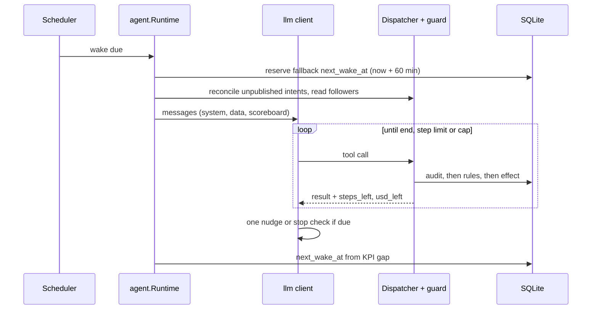

# Wake: what happens in one wake, per phase, and how the KPI scoreboard and cadence work?

A wake is one bounded LLM conversation. Three harness-owned phases exist: `agent`, `dream`, `metrics`. Code, not the agent, schedules the next agent wake from the KPI gap.

## One agent wake

| Step | Fact |
|---|---|
| 1. Wake | The harness wakes the agent at the time code set last wake, within the frequency limit |
| 2. Context | One builder assembles every phase. System prompt from the template in fixed sections: who you are, starting voice, examples (rejected drafts labelled), hard limits, the phase's job and tools, harness rules. The hard limits are the only blocks |
| 3. Inbox | Before the first request code reads the conversation inbox ([threads.md](threads.md)). When it is not empty, the data message starts with an `inbox` section above everything else: per reply its `ref`, `target_id`, `author`, `text` (untrusted, redacted), `replying_to` (first line of our text it answered) and `age_minutes`, newest first, at most 10; replies of a conversation already at `limits.replies_per_conversation` ([guards.md](guards.md)) are left out. The wake text tells the agent to answer these first, each at most once, and to skip one that needs no answer. The writer and critic run as for any reply |
| 4. Data message | Scoreboard (when `kpi:` exists), open owner notes as first task, code-computed metrics, remaining budget, the agent's own actions of the last 24 hours (newest first, at most 30 actions and 8 KiB of redacted text, each cut at 500 bytes) with today's counters against the limits |
| 5. Loop | The agent calls tools until it ends or hits the step or token limit. Results enter the conversation verbatim |
| 6. Every call | Passes the guards, is written to the audit log, then executes ([guards.md](guards.md)) |
| 7. End | The agent ends in text. Code sets `next_wake_at` |

Measured on the VPS dry-run database: 9 wakes of 9 to 15 steps carry 9,883 to 75,554 prompt tokens summed over all requests; the last request holds at most `2 × tokens_in ÷ steps` tokens (at most 12,658). Results are bounded and older ones summarized only for a request whose prompt exceeds 32,000 tokens; no wake has reached it. Stored `tool_calls.result_json` is a 29 to 34 byte stub, so per-tool result sizes are not recorded.

| Context limit | Value |
|---|---|
| Metrics in context | At most 20 recent own confirmed-action samples; absent samples stay absent |
| Owner answers | Latest ten, secrets redacted |

## Phases

| Phase | Trigger | Tools | Writes | Spend |
|---|---|---|---|---|
| `agent` | `next_wake_at`; a fresh webhook reply or mention | All, see [tools.md](tools.md) | Threads, owner | `limits.max_usd_per_day` |
| `dream` | `schedule.dream_at`, once per local day | Reads | None to Threads or owner | `limits.max_usd_per_dream` (default 0.30), `limits.max_steps_per_dream` (default 8), excluded from the daily cap |
| `metrics` | Due metric targets | None (no model call) | Metric samples only | None |

A dream wake uses `wakes.kind` and a durable `phase_key`; a partial unique index makes one dream per local day unrepeatable, restarts included. A dream missed while the process was down runs once on the next start. A dream does not move `next_wake_at`. Spend rows carry the phase, so the dashboard and the daily report show wake and dream spend separately. `critic` is a third ledger phase for the pre-publish review ([content.md](content.md)).

Phase keys: `schedule.timezone` (IANA, default `Asia/Ho_Chi_Minh`), `schedule.dream_at`. Full list: [template.md](template.md).

## KPI scoreboard

Optional `kpi:` block: `engagements_per_day`, `followers_per_week`, `max_hours_without_publish`, `on_target_minutes_between_wakes` (all required once any exists). Without it there is no scoreboard and the agent is never behind.

| Scoreboard line | Computed from |
|---|---|
| Spend and tokens | Today (local day in `schedule.timezone`) and 7 days, all phases |
| Wakes today | Agent wakes started on the local day |
| Last published action | Hours since the newest non-failed own action in the template's mode |
| Engagements | Likes + replies + reposts + quotes in the newest metrics of own actions posted in the last 24 hours, against `engagements_per_day` |
| Followers | Account followers gained in the last 7 days: the newest follower count measured in that window minus the oldest (never negative), against `followers_per_week` |
| Next post | When the newest own post plus `limits.min_minutes_between_posts` has not passed, the local time and minutes until a post is allowed (the guard's own rule); when today's `posts_per_day` is used, a line saying no more posts today; otherwise no line |
| Cost per engagement | Spend today over engagements in 24 hours |
| Gap line | `behind: 3 of 40 engagements in 24h after $0.12 and 4 wakes today; nothing published for 9h`, or `on target: ...` |

The text says that pressure means more and better ideas, never lower quality: the critic still decides and the caps still hold.

| Condition | Behind when |
|---|---|
| Engagements | Under the daily target |
| Never published | True |
| Publish age | `max_hours_without_publish` old or older |

An agent on target is never sent a stop check. A behind agent gets one extra turn per wake (`llm.MaxStopNudges` = 1) when the model stops calling tools. It names `ideas` when offered and not called, the posts the agent read that still score well and are unanswered (while budget is left; no reply count is imposed). After that turn the wake ends whatever the model does. Replies are never required.

## Cadence

| Situation | Next wake |
|---|---|
| Wake ends normally or at a step, budget or action limit; behind | `limits.min_minutes_between_wakes` |
| Same, on target | `kpi.on_target_minutes_between_wakes` |
| Same, no `kpi:` block | One hour, or the minimum if longer |
| Day capped: today's agent spend reached `max_usd_per_day` or both `posts_per_day` and `replies_per_day` used (in the template's mode, as the guard counts), all on the local day in `schedule.timezone` | The next local midnight, whatever the gap |
| Fresh webhook reply or mention arrived since the latest wake started | Now, but never closer than `min_minutes_between_wakes` after that wake started |
| The inbox poll found a reply not seen before (every `inbox.poll_minutes` between wakes; 0 disables) | Now, but never closer than `inbox.min_minutes_after_wake` after the latest wake started. The poll is API reads only, no model call; a reply is remembered once polled or listed in a wake, so it asks for at most one early wake (the memory is lost on restart). A failed poll backs off 15 minutes, doubling up to 4 hours, and never stops the process. A paused or killed agent is not polled. Spend caps and pacing are unchanged |
| Wake fails | The fallback below |

The agent has no tool to schedule a wake.

## Recovery and loop rules

| Rule | Fact |
|---|---|
| Fallback schedule | A wake reserves `now + 60min` (or the minimum if longer) before any tool runs |
| Restart | Closes open agent wakes as `interrupted`; retires unfinished tool audit outcomes as unknown/assumed sent with retry disabled; moves the schedule to at least the fallback. Never reloads the conversation or executes pending intent. Paused and killed agents stay stopped |
| No replay | An interrupted wake is never re-run. A `post` or `reply` with an unknown outcome is recorded as sent and never retried |
| Stall stop | Calls are keyed by tool name and canonical arguments; the dispatcher hashes each result. A call that failed the same way 3 times is refused without running (`repeat_refused`). The wake ends (`stall_stop`) at the second refusal, or when one call returns the same successful result 10 times. A different result resets the count |
| Result trailer | Every tool result ends with `{"steps_left": N, "usd_left": X}` (steps left and USD left under the phase's daily cap) |
| Browser | At most one browser per wake, started on the first `read_feed`, closed on every exit. A close failure is logged as `wake.cleanup.failed` and does not change `end_reason` ([threads.md](threads.md)) |

## Trends and reply targets

| Item | Fact |
|---|---|
| `fetch_trends` | Round-robin across Hacker News, Product Hunt, Google Trends VN unless `trends.sources` picks others; no model call |
| Sources | Google News (VN, global, per-topic), VN tech RSS (VietnamNet serves the former ICTnews feed), global tech RSS, Hacker News, Product Hunt, Google Trends VN, public GitHub trending. IDs validated against a fixed set ([template.md](template.md)); none needs credentials |
| Failure | Each source fails soft under per-source and overall timeouts; the same story across sources is clustered and scored once |
| Not implemented | Open X/Facebook/TikTok feeds: no stable no-login source was measured |
| Ranking | Deterministic for `trends.include_keywords`, dropping `trends.avoid_keywords`; omitted lists derive from persona topics, research focus and avoid topics |
| Reply-target score of a read post | Mean of five terms in [0,1]: freshness (`1 - age / targets.max_age_minutes`; neutral 0.5 when the age is unknown), room (`1 - replies / targets.max_replies`, when the replies are known), momentum (likes per hour over `targets.min_likes_per_hour`: `x / (x + min)`; likes per hour is likes over the age in hours with the age floored at 10 minutes; 0 when likes are unknown), and two neutral terms, author size (0.5) and novelty (1), because neither is observed. A post older than `max_age_minutes`, with more than `max_replies` replies, fewer than `min_likes_per_hour` likes per hour or, when `min_likes` is above 0, fewer than `min_likes` likes is flagged `outside window` with the knobs it breaks, scores 0 and is still listed; a reply to it is refused (`target_outside_window`, [guards.md](guards.md)) |
| Topic heat | Mean of the terms with evidence, each in [0,1]: post volume (`n / (n + 1000)` of the Trending-now count), coverage (`(sources - 1) / (sources - 1 + 1)` of the distinct sources in the story's cluster this fetch), recency (`360 / (360 + minutes since the story was first listed by a fetch_trends of this agent)`; 1 for a story not listed before) and rank movement (`0.5 + 0.1 * places climbed since the previous fetch`, clamped). A Trending-now item has post volume only. A topic with no evidence has no heat |
| Stored on a reply | When the wake read the target, the guard stores the target score with likes, likes per hour and the `outside_window` flags in `target_score_json`, plus `parent_replies` and `parent_age_minutes`; an action anchored to a topic with heat stores it as `topic_heat`. A figure the page did not show stays null. A never-read target stays unscored |

## Metrics phase

A `wakes.kind='metrics'` scope calls the guarded `read_own_metrics` route with no model call, token spend or write tool, and never changes `next_wake_at`. Paused and killed agents perform no reads. A pass that claims nothing leaves no `wakes` row. Job mechanics: [learning.md](learning.md).

## Offline and soak

| Command | Behaviour |
|---|---|
| `run --once --offline` | Isolated temporary DB, built-in synthetic template with dummy credentials, scripted LLM transport, synthetic trend, web-search and Threads fixtures. No environment credentials, no network. Rejects non-dry-run templates. The dispatcher has no default outside fetchers; constructing it without injected trend and web-search fetchers is an error |
| `eval soak --soak-hours` | Injected logical time and a real SQLite close/reopen to simulate a restart; evidence is synthetic |
| `eval soak --soak-agents 2` | Two synthetic identities, independent pause/kill/quota/budget phases, serial metric maintenance, labelled Go memory samples with fake backends (no Chromium RSS) |

Implementation: [`internal/agent/isolation_soak.go`](../internal/agent/isolation_soak.go); fixtures in [`internal/agent`](../internal/agent) and [`internal/eval/testdata/runtime.json`](../internal/eval/testdata/runtime.json).

## Events

A chat request retries up to 3 attempts: on 429 and 5xx it waits the provider's `Retry-After` (seconds or HTTP date, at most 60 s), else 1 s then 2 s plus up to 25% jitter; one transport error or request timeout is retried once, which can at worst pay for the same completion twice (publishing is guarded by the dispatcher, not the model call). Each retry is a `llm.request.retry` event.

Client events cover run start/finish/stop, request start/finish/retry, usage accounting and dispatcher results. Correlation uses operator-configured agent/provider/profile/model/protocol IDs, wake ID, a local request sequence, the attempt and a locally derived tool call ID (wake/step), never a provider ID. `threads.Reason` is the single mapping from backend errors to reason codes (`cancelled`, `timeout`, `logged_out`, `captcha`, `write_refused`, ...); the dispatcher and the wake end add only their own. The dispatcher emits one `browser.operation.finished` per configured-backend operation. Allowlist: [guards.md](guards.md).
